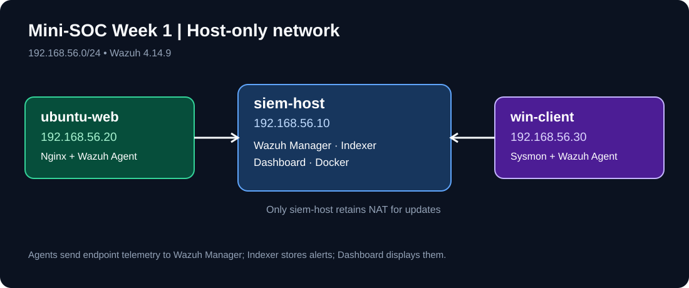

# Mini-SOC in a Box — Week 1: Build the Lab and Deploy Wazuh

A documented three-VM Security Operations Centre (SOC) lab for the fictional **LabShop** environment. This Week 1 repository records the network build, Wazuh Docker deployment, endpoint onboarding, Sysmon visibility, event validation and persistence tests. It follows the Week 1 student brief; the project continues in later weeks.

## Lab architecture
The physical host runs three VMs on an isolated host-only segment. `siem-host` runs a single-node Wazuh Docker stack (Manager, Indexer and Dashboard); `ubuntu-web` runs Nginx and a Wazuh Linux agent; `win-client` runs a Wazuh Windows agent and Sysmon. Only the SIEM host retains NAT for updates. 

See [architecture/network-diagram.md](architecture/network-diagram.md) and [architecture/ip-address-table.md](architecture/ip-address-table.md).

| VM | OS | Target RAM | vCPU | Target disk | Network |
|---|---|---:|---:|---:|---|
| siem-host | Ubuntu Server LTS | 16 GB | 6 (min 4) | 250 GB | Host-only + NAT |
| ubuntu-web | Ubuntu Server LTS | 2 GB | 2 | 40 GB | Host-only |
| win-client | Windows 10/11 | 4 GB | 2 | 80 GB | Host-only |

These resources are the **assignment targets**. Host-only addresses observed in the lab: siem-host `192.168.56.10`, ubuntu-web `192.168.56.20`, win-client `192.168.56.30`. Hardware settings are documented in the available screenshots.

## Evidence guide

Evidence is grouped by the Week 1 grading requirements. Only selected screenshots relevant to the assignment are included, rather than every installation step.

| Requirement | Evidence folder / key screenshot |
|---|---|
| L1–L3: VMs, network and connectivity | `evidence/01-virtual-machines/`, `evidence/02-networking/` |
| L4, W1–W2: Docker and Wazuh | `evidence/03-docker-wazuh/` (screenshots 44, 60, 115–117, 136) |
| W3: administrator password update | `evidence/03-docker-wazuh/` (screenshots 119–120) |
| W4: stop/start and reboot | `evidence/03-docker-wazuh/` (screenshots 121–124) |
| W5: idle container memory | `evidence/03-docker-wazuh/` (screenshot 118) |
| A1–A3: Linux/Windows agents and Sysmon | `evidence/04-agents-sysmon/` |
| A4: Nginx web server | `evidence/02-networking/` (screenshots 32–39) |
| V1: five test events | `evidence/05-security-events/` and table below |
| L5: VM snapshots | `evidence/06-snapshots/` |
| S2: isolation | `evidence/02-networking/` (screenshots 125–129) |

## Five validated security events

All five alert rule IDs and levels below were checked in expanded Wazuh event details (October 2026). These are **lab observations**, not claims of attack or compromise. Historical evidence is preserved alongside the new expanded screenshots.

| Validation test | Wazuh rule ID | Rule level | Wazuh description | Evidence |
|---|---:|---:|---|---|
| Failed SSH login | **5760** | **5** | `sshd: authentication failed.` | [SSH evidence](evidence/05-security-events/SCREENSHOT%20114%20—%20SSH%20Failed%20Login%20Alert%20Details.png) |
| Sudo command | **5402** | **3** | `Successful sudo to ROOT executed.` | [Expanded details](evidence/05-security-events/VERIFIED%2001%20—%20Sudo%20Command%20Rule%20Details.png) |
| New Linux user | **5902** | **8** | `New user added to the system.` | [Expanded details](evidence/05-security-events/VERIFIED%2002%20—%20Linux%20User%20Creation%20Rule%20Details.png) |
| Sysmon process creation | **92031** | **3** | `Discovery activity executed` (Sysmon EID 1) | [Expanded details](evidence/05-security-events/VERIFIED%2003%20—%20Sysmon%20Process%20Creation%20Details%20A.png) |
| Failed Windows logon | **60122** | **5** | `Logon Failure - Unknown user or bad password` (Windows EID 4625) | [Expanded rule](evidence/05-security-events/VERIFIED%2005%20—%20Windows%20Failed%20Logon%20Rule%20Details.png) |

**Additional investigation notes:** The Linux account creation event shows `testuser` on `ubuntu-web` (MITRE T1136). The sudo event shows `/usr/sbin/deluser --remove-home testuser` (MITRE T1548.003). Sysmon recorded `C:\Windows\SysWOW64\net1.exe` and command `net1 user` on `win-client` (MITRE T1087). The failed Windows logon had Logon Type 2; a failed logon alone is not proof of compromise.

## How an event becomes an alert
1. A user or process performs an action on the Linux or Windows endpoint.
2. Linux logs / Windows Event Log / Sysmon record the action.
3. The local Wazuh agent reads the configured log source and forwards it to the Wazuh Manager.
4. The Manager decodes the event and applies detection rules, generating an alert when a rule matches.
5. The Wazuh Indexer stores alert records and the Dashboard displays them for investigation.

## Wazuh deployment and version
- Deployment: Docker Compose single-node stack on `siem-host`.
- **Exact deployed version:** `4.14.9` (Manager, Indexer and Dashboard), confirmed in screenshot 117. Refer to [SCREENSHOT 117 — Wazuh Version Verification.png](evidence/03-docker-wazuh/SCREENSHOT%20117%20—%20Wazuh%20Version%20Verification.png); confirmed in the captured evidence.
- **Indexer kernel setting:** [SCREENSHOT 115 — Kernel Setting Persistence Verification.png](evidence/03-docker-wazuh/SCREENSHOT%20115%20—%20Kernel%20Setting%20Persistence%20Verification.png).
- **Container health:** [SCREENSHOT 116 — Wazuh Containers Running.png](evidence/03-docker-wazuh/SCREENSHOT%20116%20—%20Wazuh%20Containers%20Running.png).
- **Idle container memory:** [SCREENSHOT 118 — Wazuh Idle Memory Usage.png](evidence/03-docker-wazuh/SCREENSHOT%20118%20—%20Wazuh%20Idle%20Memory%20Usage.png); use actual values from `docker stats --no-stream` in the table below.

| Container | Idle memory measurement |
|---|---|
| Wazuh Manager | 1.052 GiB (screenshot 118) |
| Wazuh Indexer | 1.646 GiB (screenshot 118) |
| Wazuh Dashboard | 255.6 MiB (screenshot 118) |

## Starting and stopping the lab
**Start:** Start `siem-host`, then `ubuntu-web` and `win-client`. On `siem-host`, change into the existing Wazuh single-node Docker Compose deployment directory and run:

```bash
docker compose up -d
docker compose ps
```

Open the dashboard via `https://<siem-host-host-only-IP>` from the physical host, and check both agents in the Wazuh Dashboard. A browser certificate warning can occur with the lab's self-signed certificate; do not assume this would be acceptable on a public production service.

**Stop:** In the same Docker Compose directory, run:

```bash
docker compose stop
```

Shut down the endpoint VMs and finally the SIEM host. Do **not** run `docker compose down -v` or remove volumes, because this can destroy stored data. To restart after a stop, run `docker compose start` or `docker compose up -d`. Persistence evidence: screenshots 121–124b. Run the commands from the existing Wazuh single-node deployment folder.

## Security and lab isolation
The endpoints should remain on host-only networking after installation; `siem-host` alone keeps NAT for updates. Network isolation evidence: screenshots 125–129. Avoid exposing credentials, private keys, certificates or sensitive configuration files in the repository. `.gitignore` excludes common secret file types but **does not prevent secrets embedded in screenshots**. Review every image before making the repository public.

Before publication, run:

```bash
git status
git ls-files
```

Check staged content manually for secrets and remove/redact any image that displays a password, token or certificate private key. Do not publish the repository until its screenshots have been reviewed for credentials and other secrets.

## Journal, snapshots and remaining validation
- [Week 1 journal](journal.md): five entries based on documented work. The student reported no significant issues, so no false failure/fix story is included.
- **Snapshot inventory:** both `w1-clean-install` and `w1-done` are visible for all three VMs: [siem-host](evidence/06-snapshots/siem-host-snapshots.png), [ubuntu-web](evidence/06-snapshots/ubuntu-web-snapshots.png), and [Demo-Windows-10 / win-client](evidence/06-snapshots/windows-snapshots.png). Snapshot dates are intentionally omitted from this report. Snapshot labels alone do not establish the historical state of each VM at capture time.
- Wazuh version and container memory measurements have been verified from screenshots. Windows host-only IP is 192.168.56.30, visible in screenshot 110 (`agent.ip`). All five Wazuh event rule IDs and levels were subsequently confirmed using expanded event screenshots.
- Check the Windows evaluation expiry date if applicable.
- Verify that no credentials or private keys are present in screenshot evidence before publishing.
- Add the GitHub repository URL after creating the repository; the assignment does not specify a particular LMS/email submission destination.

## Evidence limitations

The screenshot set demonstrates many practical tasks, but not every rubric requirement is independently verified. In particular, the GitHub repository URL and published repository security checks remain outstanding until upload. These are documentation/evidence gaps, not claims that the lab failed. The student reported no significant technical issues.

## References
Week 1 student brief; official Wazuh Docker and agent documentation, Docker Engine documentation and Microsoft Sysmon documentation. This repository contains lab evidence rather than a claim of production hardening.
